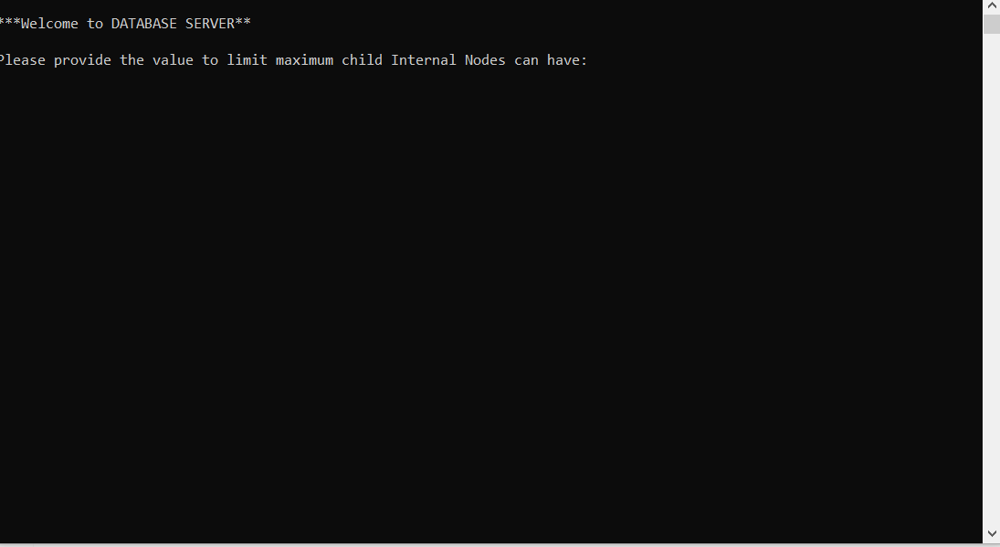
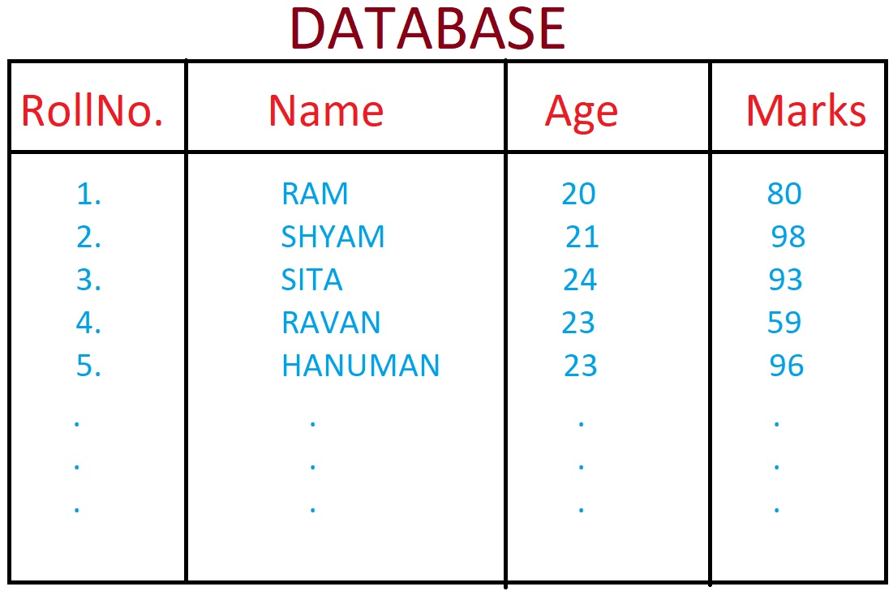
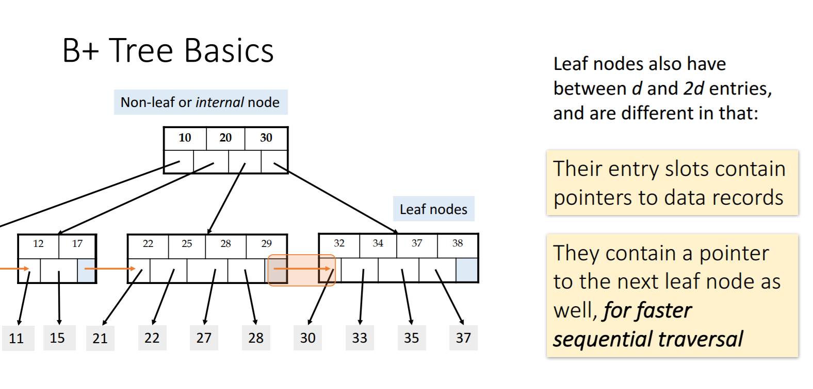
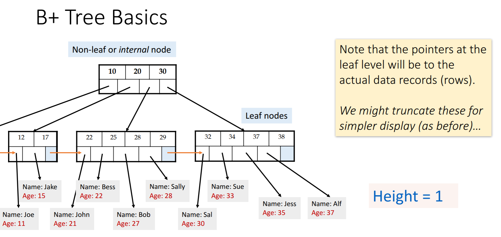
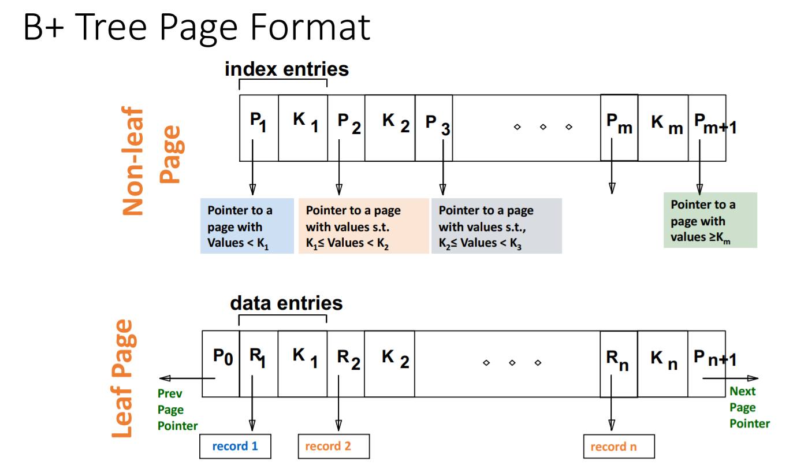
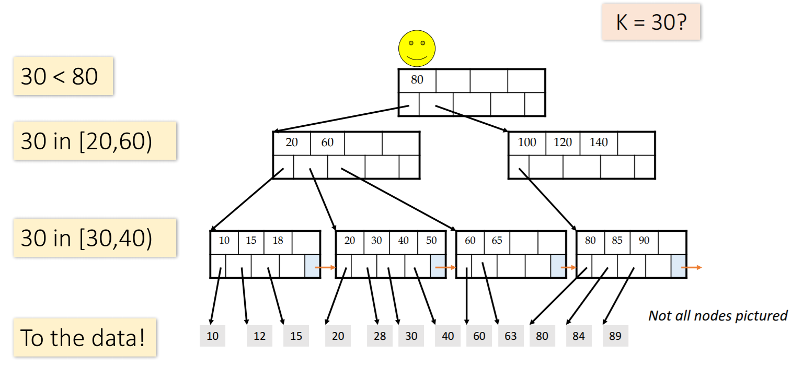
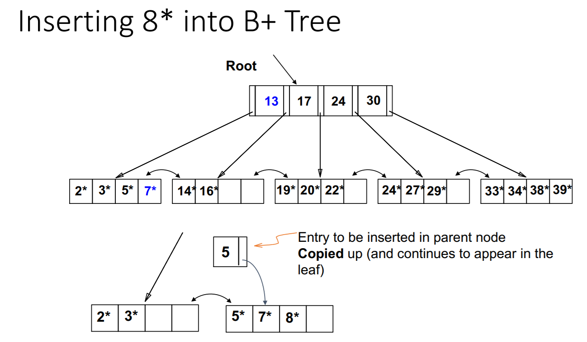
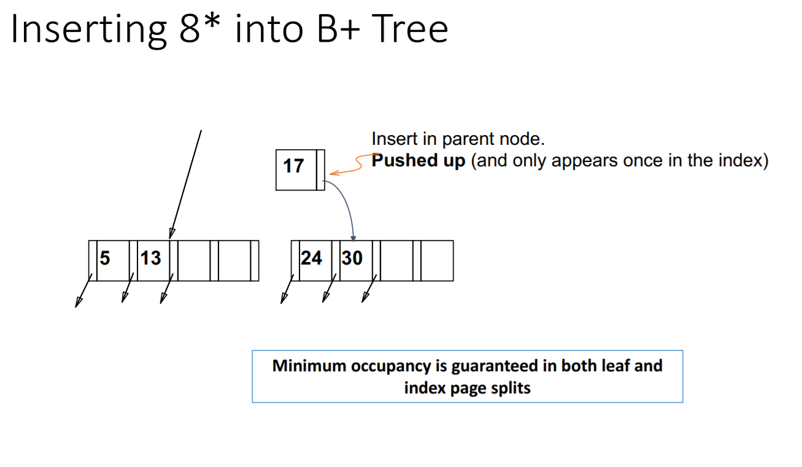
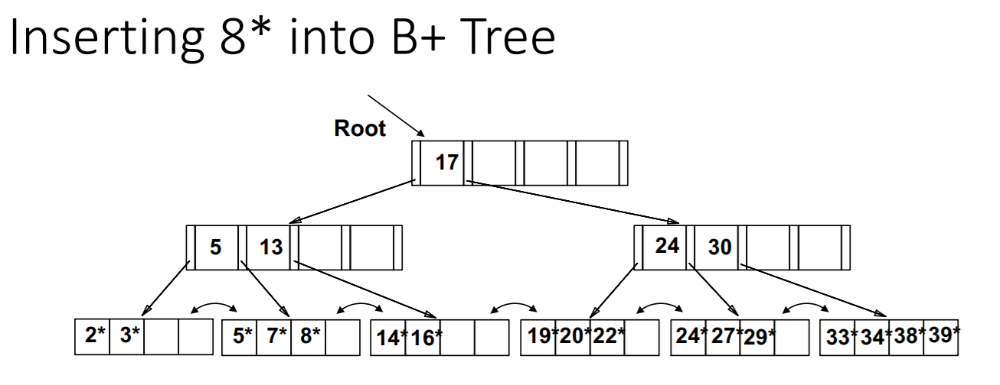

# B+ Tree
Implementing B+ tree using C++
- [x] Search 
- [X] Insert
- [X] Structuring the main Function
- [X] Delete
- [X] Range Search

## Demo :



## Usage :

1.	Clone it to some place in your PC.
2.	Compile with any C++11 (or newer) compiler, e.g. g++:
	```
	g++ -std=c++17 -o bptree.exe "B+ Tree.cpp" insertion.cpp search.cpp remove.cpp display.cpp utilFunc.cpp
	```
	(Visual Studio also works: File->create new project with existing code.)
3.	Run `./bptree.exe`, choose the maximum children for internal nodes and maximum keys for leaf nodes, then use the menu to insert, search, range search, print and delete.
(PS. Create an issue if you find any bug. Will be happy to fix it :))
HAPPY CODING !!

## Default DataBase Schema :

Our DataBase Schema Will look something like this-
	


## Summary- What is the project all about? 

This project is a small version of a database system: a C++ Student DBMS built on a custom B+ Tree, with dynamic splits,
merges and primary-key inserts for O(log N) lookup. Every student tuple is stored as a .txt file in the DBFiles folder and
the corresponding FILE* is saved in the leaf node as its data pointer. This mimics disc-block access. The files persist
between runs: on startup the records in DBFiles are loaded back and the index is rebuilt. If we want to make more tables
then we can make that many BPTree objects !!

## Project Design :

| File | Responsibility |
|---|---|
| `B+ Tree.h` | `Node` hierarchy and the `BPTree` class |
| `insertion.cpp`, `search.cpp`, `remove.cpp`, `display.cpp`, `utilFunc.cpp` | B+ Tree operations, one module each |
| `RecordStore.h` | Storage layer: abstract `RecordStore` interface and `FileRecordStore` (DBFiles) |
| `StudentDatabase.h` | Connects the index (`BPTree`) with the storage (`RecordStore`) |
| `B+ Tree.cpp` | `main`: menu and user input only |

- **Inheritance :** `Node` is an abstract base class (pure virtual `isLeaf()`). `LeafNode` (keys, FILE* data pointers, link
  to next leaf) and `InternalNode` (keys, child pointers) inherit from it. `FileRecordStore` inherits from `RecordStore`.
- **Encapsulation & Friend Classes :** node members are private and only `BPTree` can access them through `friend class BPTree`.
  The tree never exposes node pointers: its public interface works only with keys and data pointers, and the constructor
  rejects limits that would break the B+ Tree properties.
- **SOLID :**
	- *Single Responsibility* - `BPTree` only indexes, `FileRecordStore` only does file I/O, `StudentDatabase` coordinates, `main` only takes input.
	- *Open/Closed* - a new storage backend is just a new `RecordStore` subclass; the tree and database code do not change.
	- *Liskov Substitution* - any `RecordStore` subclass works where a `RecordStore&` is expected, and both node types work as a `Node*`.
	- *Interface Segregation* - `RecordStore` has only the four operations the database needs (write, read, remove, loadAll).
	- *Dependency Inversion* - `StudentDatabase` depends on the `RecordStore` abstraction, not on the concrete file store.

## Assumptions in our Tree :

1.	We are making a left biased tree. By this we mean if a full node cannot be split into two equal halves,
	the left node keeps one element more than the right sibling.

2.	Insertion is based on the primary key. Hence all the properties of the primary key has to be followed.
	Duplicate insertion with the same primary key is rejected!

3.	Nodes do not store a parent pointer. Splits, merges and borrows move children between nodes, so every moved child's
	parent pointer would need updating. Instead, the parent of a leaf is remembered while descending (`findLeaf`), and
	higher parents are found with `findParent`. (Keeping a stack of visited nodes on the way down would make this O(log N).)

4.	We are saving the \*ptr2next explicitly while ideally it is saved as the last pointer in the pointerset. Leaf and
	non-leaf nodes are separate classes (`LeafNode` and `InternalNode`), so only `LeafNode` has \*ptr2next and its data
	pointers, while `InternalNode` has only child pointers !!


## Some UseFul Properties of B+ Tree:

1. B+ Tree Unlike B Tree is defined by two order values one for leaf node and another for non-leaf node.
	Minimum 50% should hold on B+ Tree Node.
	a.	For Non-Leaf Nodes-
		i.	ceil(maxInternalLimit/2)<= #of children <= maxInternalLimit
		ii.	ceil(maxInternalLimit/2)-1<= #of keys <= maxInternalLimit-1
		
	b.	For Leaf Nodes-
		i.	ceil(maxLeafLimit/2)<= #of keys <= maxLeafLimit
		ii.	since Leaf node will point to the dataPtr. It will be of same size as maxLeafLimit to correspond
			to every key !!!

	
	
	


## Search:

1.	If x is non-leaf node, we seek for the first *i* for which **keyValue** which is greater 
	than or equal-to the key k searched for. After that search continues in the node pointed 
	by ***iptr2Tree***.

2.	If all the **keyValue** are smaller than k then, we continue to search in the node pointed
	by ***(maxInternalLimit)ptr2Tree***.

3.	If x is a leaf-node, we search if k is present in the node!


	


## Range Search:

To find every key k with low <= k <= high:

1.	Descend once from the root to the leaf where *low* would be (same as Search) - O(log N).

2.	From there, walk right using ***ptr2next*** through the linked leaves, collecting keys until a key
	greater than *high* is found - O(K) for K results.

Total cost is O(log N + K). This is the reason B+ Tree leaves are linked: a hash index would have
to scan every record to answer a range query.


## Insertion:

There are two convention being followed for the insertion(according to the google what i found out)
where, if the current node becomes full then -

1.	First give an element to the left sibling and if that doesn't
work give an element to the right sibling and if this also doesn't work split it.

2.	Simply Split into two nodes.

**Major Drawback of 1**
	Increases I/O, especially if we	check both siblings!!!


We have followed 2nd method which was comparatively easy to implement with relatively less hustle. So, 
here is the complete algorithm for [reference](http://www.cburch.com/cs/340/reading/btree/index.html?fbclid=IwAR0QFRcpIVL19PdMtZU0-wG18f-rwGS4lNvzpEAsdaZCL7BrNRBuFffiPJ0)

Descend to the leaf node where leaf fits :
a.	If the node has empty space, insert the key/reference pair into the node and We are DONE!
b.	If the node is already full, split it into two nodes, distributing the keys evenly. 
	i.	If the node is leaf,take the copy of minimum in the second node and repeat this algorithm to 
		insert it in parent node.
	ii.	If the node is non-leaf, exclude the middle value during split and insert the excluded value into 
		the	parent.

Let's see what would happen if we insert 8 in the below tree :-
	
	
	
